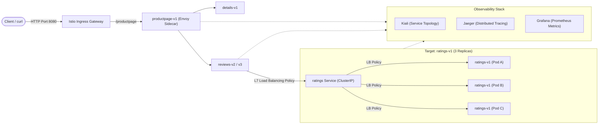

# Istio Service Mesh: Traffic Routing & Load Balancing Policies on Kubernetes (Minikube)

[](https://kubernetes.io/)
[](https://istio.io/)
[](https://minikube.sigs.k8s.io/)
[](https://kiali.io/)
[](https://www.jaegertracing.io/)
[](https://grafana.com/)

An end-to-end hands-on project demonstrating advanced Layer 7 (L7) traffic routing and load balancing policies using **Istio Service Mesh** on a **Minikube** cluster with the canonical **Bookinfo** microservices application.

We configured and benchmarked 3 core Istio `DestinationRule` load balancing algorithms on a multi-replica microservice (`ratings-v1` scaled to 3 pods) and analyzed traffic distribution in real time using **Kiali**, **Jaeger**, and **Grafana**:
1. **Round Robin** (`ROUND_ROBIN`)
2. **Least Connections** (`LEAST_CONN`)
3. **Consistent Hashing** (`CONSISTENT_HASH` with custom HTTP headers)

---

## 🏗️ Architecture & Topology

Traffic enters the cluster through the **Istio Ingress Gateway**, flows to `productpage`, calls `reviews`, and subsequently fans out to the `ratings` microservice. Envoy sidecar proxies dynamically manage request dispatching based on our declared `DestinationRule` policies without altering application source code.



---

## 📂 Repository Structure

```text
.
├── README.md                               # Project documentation
├── manifests/
│   ├── bookinfo.yaml                       # Bookinfo microservices deployment
│   ├── bookinfo-gateway.yaml               # Gateway and VirtualService for ingress traffic
│   ├── ratings-scale-replicas.yaml         # Replica scale definition (3 pods)
│   └── destination-rules/
│       ├── dr-round-robin.yaml             # Policy 1: Round Robin DestinationRule
│       ├── dr-least-conn.yaml              # Policy 2: Least Connections DestinationRule
│       ├── dr-consistent-hash-header.yaml  # Policy 3: Consistent Hashing (Header: x-user)
│       └── dr-consistent-hash-ip.yaml      # Policy 3 (Variant): Source-IP hashing
├── telemetry/
│   └── tracing-telemetry.yaml              # Istio Telemetry CRD for Jaeger/Zipkin tracing
├── scripts/
│   ├── deploy.sh                           # One-shot cluster bootstrap and app deployment
│   ├── expose_services.sh                  # Helper script for port-forwarding all dashboards
│   └── generate_traffic.sh                 # Traffic generation script (Continuous, Header, Burst)
└── docs/
    ├── REPORT.md                           # Detailed French experimental report
    └── images/                             # High-resolution Kiali experiment screenshots
        ├── round_robin_kiali.png
        ├── least_conn_kiali.png
        ├── consistent_hash_kiali_header.png
        └── consistent_hash_kiali_graph.png
```

---

## ⚡ Quick Start & Reproduction Guide

### Prerequisites
* **Minikube** (v1.30+)
* **kubectl**
* **istioctl** (v1.20+)

### 1. Start Cluster & Install Istio
```bash
# Start Minikube with sufficient resources
minikube start --cpus=4 --memory=8192

# Install Istio with the demo profile (includes Kiali, Jaeger, Prometheus, Grafana)
istioctl install --set profile=demo -y

# Enable automatic Envoy sidecar injection on the target namespace
kubectl create namespace bookinfo
kubectl label namespace bookinfo istio-injection=enabled
```

### 2. Deploy Bookinfo & Scale Target Pods
```bash
# Deploy microservices and gateway
kubectl apply -n bookinfo -f manifests/bookinfo.yaml
kubectl apply -n bookinfo -f manifests/bookinfo-gateway.yaml

# Enable mesh distributed tracing (Zipkin / Jaeger)
kubectl apply -f telemetry/tracing-telemetry.yaml

# Scale the ratings service to 3 replicas for load balancing tests
kubectl scale deployment ratings-v1 -n bookinfo --replicas=3

# Verify rollout status
kubectl rollout status deployment/ratings-v1 -n bookinfo
```

### 3. Expose Services & Dashboards
Run the pre-configured port-forwarding script in a separate terminal:
```bash
./scripts/expose_services.sh
```
Access the endpoints in your browser:
* **Product Page (App):** [http://localhost:8080/productpage](http://localhost:8080/productpage)
* **Kiali Console:** [http://localhost:20001/kiali](http://localhost:20001/kiali)
* **Jaeger Tracing:** [http://localhost:16686](http://localhost:16686)
* **Grafana Dashboards:** [http://localhost:3000](http://localhost:3000)

---

## 🧪 Experiments & Load Balancing Policies

### Policy 1: Round Robin (`ROUND_ROBIN`)
The default algorithm in Envoy. It sequentially cycles through all healthy backend instances ($A \to B \to C \to A \dots$).

* **Apply Manifest:**
  ```bash
  kubectl apply -f manifests/destination-rules/dr-round-robin.yaml
  ```
* **Traffic Simulation:**
  ```bash
  ./scripts/generate_traffic.sh continuous
  ```
* **Observed Result:**
  Kiali shows an even traffic split of approximately **~33.3%** across each of the 3 `ratings-v1` pods.


---

### Policy 2: Least Connections (`LEAST_CONN`)
Envoy routes incoming requests to the backend pod currently handling the fewest active connections. This is particularly effective for workloads with variable processing times or long-lived connections.

* **Apply Manifest:**
  ```bash
  kubectl apply -f manifests/destination-rules/dr-least-conn.yaml
  ```
* **Traffic Simulation:**
  ```bash
  ./scripts/generate_traffic.sh burst 150
  ```
* **Observed Result:**
  Because Bookinfo requests are short-lived HTTP calls, traffic distribution closely mirrors Round Robin in steady state, but actively adapts when latency or burst spikes occur.


---

### Policy 3: Consistent Hashing (`CONSISTENT_HASH`)
Guarantees session affinity (stickiness) by hashing a designated request attribute (such as an HTTP Header, Cookie, or Client Source IP). All requests sharing the same key hash to the **exact same backend pod**.

* **Apply Manifest (HTTP Header `x-user`):**
  ```bash
  kubectl apply -f manifests/destination-rules/dr-consistent-hash-header.yaml
  ```
* **Test Stickiness:**
  ```bash
  ./scripts/generate_traffic.sh header 100
  ```
* **Observed Result:**
  * Requests with `x-user: user1` are consistently directed to **Replica #1**.
  * Requests with `x-user: user2` are consistently directed to **Replica #2**.
  * The session stickiness persists deterministically across thousands of invocations.


---

## 📊 Policy Comparison Matrix

| Load Balancing Policy | Envoy Config | Best Use Case | Traffic Distribution | Session Affinity |
| :--- | :--- | :--- | :--- | :--- |
| **Round Robin** | `simple: ROUND_ROBIN` | Stateless, homogeneous workloads with uniform latency. | Exactly equal (~33% per pod) | ❌ None |
| **Least Connections** | `simple: LEAST_CONN` | Heterogeneous, compute-heavy, or variable-latency workloads. | Dynamic balance based on active load | ❌ None |
| **Consistent Hashing** | `consistentHash: { httpHeaderName: x-user }` | Stateful services, local in-memory caches, sticky user sessions. | Deterministic (100% of given key to 1 pod) | ✅ Strict (Key-based) |

---

## 🔍 Observability Stack Overview

* **Kiali**: Visualizes real-time request rates, topology graphs, and percentages across individual service workloads.
* **Jaeger**: Traces end-to-end HTTP spans across microservices (`productpage` $\to$ `reviews` $\to$ `ratings`), measuring latency per hop and verifying header propagation.
* **Grafana**: Provides Istio Service and Workload dashboards displaying request volume, P50/P90/P99 latency, and Envoy connection pool health.

---

## 🧹 Cleanup
To tear down the deployed resources:
```bash
kubectl delete namespace bookinfo
istioctl uninstall --purge -y
minikube stop
```

---

## 📄 License & Credits
* Original application: [Istio Bookinfo Sample Application](https://istio.io/latest/docs/examples/bookinfo/)
* Tested and documented by [Ines Ben Yghzer](https://github.com/)
