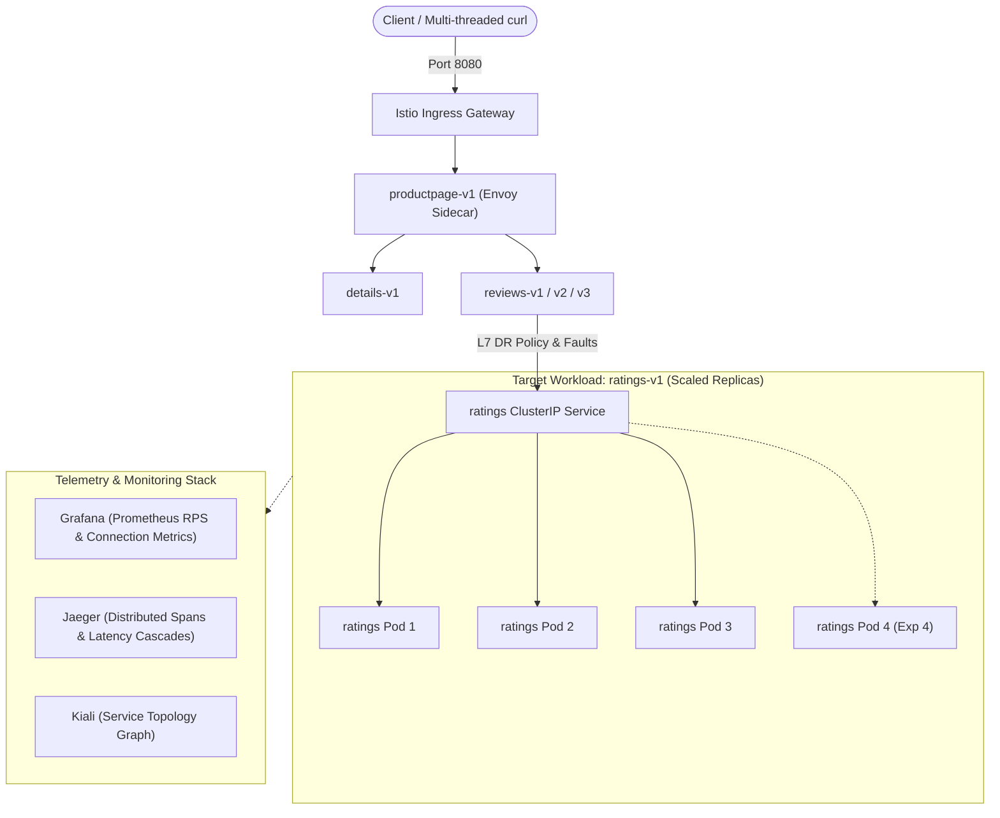

# Istio Service Mesh: Traffic Routing, Load Balancing & Resilience Lab

[](https://kubernetes.io/)
[](https://istio.io/)
[](https://grafana.com/)
[](https://www.jaegertracing.io/)
[](https://kiali.io/)

A comprehensive hands-on engineering project exploring **Layer 7 (L7) Traffic Routing**, **Load Balancing Policies**, and **Resilience under Fault Injection** using **Istio Service Mesh** on **Kubernetes (Minikube)** with the canonical **Bookinfo** microservices application.

The target service under evaluation is the `ratings` microservice (scaled to 3 and 4 pods), instrumented with full observability across **Grafana** (metrics), **Jaeger** (distributed tracing), and **Kiali** (service mesh graph).

---

## 🔬 Experimental Scenarios Overview

| # | Experiment | Target Focus | Concurrency & Faults | Observability Tool | Key Finding |
|---|---|---|---|---|---|
| **1** | **Ratings Replication** | 3 Replicas | Default traffic | Kiali | Native Envoy Round Robin balances traffic equally (~33% per pod). |
| **2** | **Round Robin DR** | `ROUND_ROBIN` | 20 Threads | Grafana | Perfectly overlapping throughput curves across all pods. |
| **3** | **Least Connections DR** | `LEAST_CONN` | 20 Threads | Grafana | Behaves similarly to Round Robin on ultra-fast sub-millisecond requests. |
| **4** | **VirtualService Weights & Faults** | 4 Pods / Weights | Weight-based routing + Faults | Kiali / Grafana | VirtualService weight routing executes first; DR load balancing distributes within subsets. |
| **5** | **5s Fault Injection Stress** | 5s Delay | 200 Threads | Grafana / Kiali | Under severe lag, `LEAST_CONN` dynamically routes traffic away from congested pods. |
| **6** | **Distributed Tracing** | 3 Pods (5s Delay) | 30 Threads | Jaeger | Visualized 5s cascade spans; verified Round Robin vs Least Connections avoidance. |
| **7** | **Consistent Hashing & Header Loss** | `CONSISTENT_HASH` (`x-user`) | Header variation | Kiali / Pod logs | **Discovery:** Headers dropped by `productpage` fallback to RR; direct calls achieve strict stickiness. |

---

## 🏗️ Architecture & Traffic Flow



---

## 📂 Repository Organization

```text
.
├── README.md                                       # Main documentation
├── .gitignore
├── docs/
│   ├── REPORT_SCENARIOS.md                         # Detailed scientific report (French)
│   └── images/                                     # Experiment screenshots organized by scenario
│       ├── exp1-ratings-replication/               # Place screenshots for Experiment 1
│       ├── exp2-round-robin-grafana-20threads/     # Place Grafana screenshots for Experiment 2
│       ├── exp3-least-connection-grafana-20threads/# Place Grafana screenshots for Experiment 3
│       ├── exp4-virtualservice-weights-fault/      # Place screenshots for Experiment 4
│       ├── exp5-fault-injection-5s-200threads/     # Place screenshots for Experiment 5
│       ├── exp6-jaeger-tracing-5s-30threads/       # Place Jaeger traces for Experiment 6
│       └── exp7-consistent-hashing-header/         # Place Kiali & stickiness logs for Experiment 7
├── manifests/
│   ├── 01-base/
│   │   ├── bookinfo.yaml                           # Bookinfo deployment
│   │   ├── bookinfo-gateway.yaml                   # Gateway & VirtualService
│   │   ├── ratings-3-replicas.yaml                 # 3-pod scale definition
│   │   └── ratings-4-pods.yaml                     # 4-pod scale definition
│   ├── 02-destination-rules/
│   │   ├── dr-ratings-round-robin.yaml             # ROUND_ROBIN policy
│   │   ├── dr-ratings-least-conn.yaml              # LEAST_CONN policy
│   │   ├── dr-ratings-consistent-hash.yaml         # CONSISTENT_HASH on x-user header
│   │   └── dr-ratings-consistent-hash-ip.yaml      # CONSISTENT_HASH on source IP
│   ├── 03-virtual-services/
│   │   ├── vs-ratings-weights.yaml                 # Weight-based split (75/25)
│   │   └── vs-reviews-weights.yaml                 # Reviews subset weights (34/33/33)
│   ├── 04-fault-injection/
│   │   ├── envoyfilter-ratings-delay-5s.yaml       # Injected 5s delay on slow pod
│   │   └── vs-ratings-fault-delay-5s.yaml          # VirtualService native fault delay
│   └── 05-telemetry/
│       └── tracing-telemetry.yaml                  # 100% trace sampling for Jaeger
└── scripts/
    ├── expose_dashboards.sh                        # Port-forward tunnels (Grafana, Jaeger, Kiali, Ingress)
    ├── run_load_test.sh                            # Multi-threaded load runner (20 / 30 / 200 threads)
    ├── test_consistent_hash.sh                     # Consistent hashing validator (productpage vs direct)
    └── apply_experiment.sh                         # One-click scenario switcher (1 to 7)
```

---

## 🚀 Quick Execution Guide

### 1. Launch Dashboards
Open a dedicated terminal window:
```bash
./scripts/expose_dashboards.sh
```
Endpoints:
* **Grafana:** [http://localhost:3000](http://localhost:3000)
* **Jaeger Tracing:** [http://localhost:16686](http://localhost:16686)
* **Kiali Console:** [http://localhost:20001/kiali](http://localhost:20001/kiali)
* **Bookinfo Ingress:** [http://localhost:8080/productpage](http://localhost:8080/productpage)

### 2. Switching Between Scenarios (1 to 7)
Use the helper script [`scripts/apply_experiment.sh`](file:///Users/inesbenyghzer/.gemini/antigravity/scratch/istio-bookinfo-loadbalancing/scripts/apply_experiment.sh):
```bash
# Activate Experiment 2 (Round Robin DestinationRule)
./scripts/apply_experiment.sh 2

# Activate Experiment 5 (5s Fault Injection)
./scripts/apply_experiment.sh 5

# Activate Experiment 7 (Consistent Hashing)
./scripts/apply_experiment.sh 7
```

### 3. Generating Concurrent Load
Run multi-threaded benchmarks using [`scripts/run_load_test.sh`](file:///Users/inesbenyghzer/.gemini/antigravity/scratch/istio-bookinfo-loadbalancing/scripts/run_load_test.sh):
```bash
# Syntax: ./run_load_test.sh <THREADS> <DURATION_SECONDS>
./scripts/run_load_test.sh 20 30    # 20 threads for 30 seconds (Experiments 2 & 3)
./scripts/run_load_test.sh 30 45    # 30 threads for Jaeger inspection (Experiment 6)
./scripts/run_load_test.sh 200 60   # 200 threads stress test (Experiment 5)
```

### 4. Running the Consistent Hashing Test
Execute the test script proving the header loss discovery:
```bash
./scripts/test_consistent_hash.sh
```

---

## 💡 Key Architectural Insights

1. **Weight Routing vs Load Balancing**:
   `VirtualService` traffic routing (e.g. 75%/25% subset weights) operates at the routing level *before* the `DestinationRule`. The `DestinationRule` load balancer (`ROUND_ROBIN` or `LEAST_CONN`) then distributes requests among the pods backing each subset.

2. **Resilience with Least Connections**:
   When a pod experiences severe delay (5s fault injection), `ROUND_ROBIN` continues blindly sending 33% of requests to the slow pod. `LEAST_CONN` senses the accumulation of open connections and automatically shunts subsequent requests to healthy pods.

3. **HTTP Header Propagation in Service Mesh**:
   Layer 7 routing features like `Consistent Hashing` on HTTP headers (`x-user`) depend entirely on downstream microservices preserving and forwarding those headers. When `productpage` drops custom headers, Envoy falls back to default Round Robin. Calling `ratings` directly verifies that the Envoy configuration is functioning as designed.

---

## 📖 Detailed Report
For in-depth mathematical descriptions, step-by-step observations, and Grafana/Jaeger analyses, see [`docs/REPORT_SCENARIOS.md`](docs/REPORT_SCENARIOS.md).
