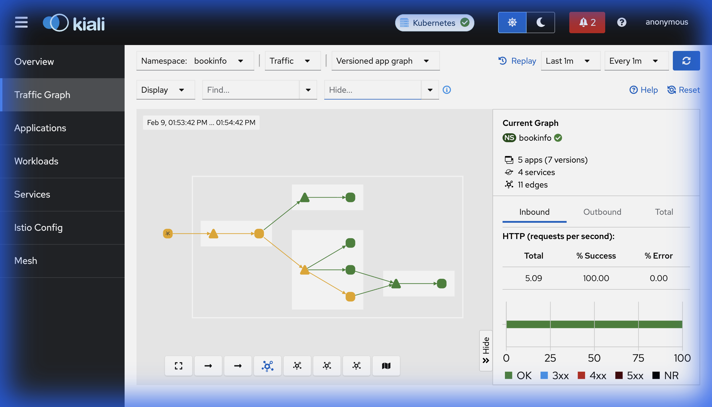
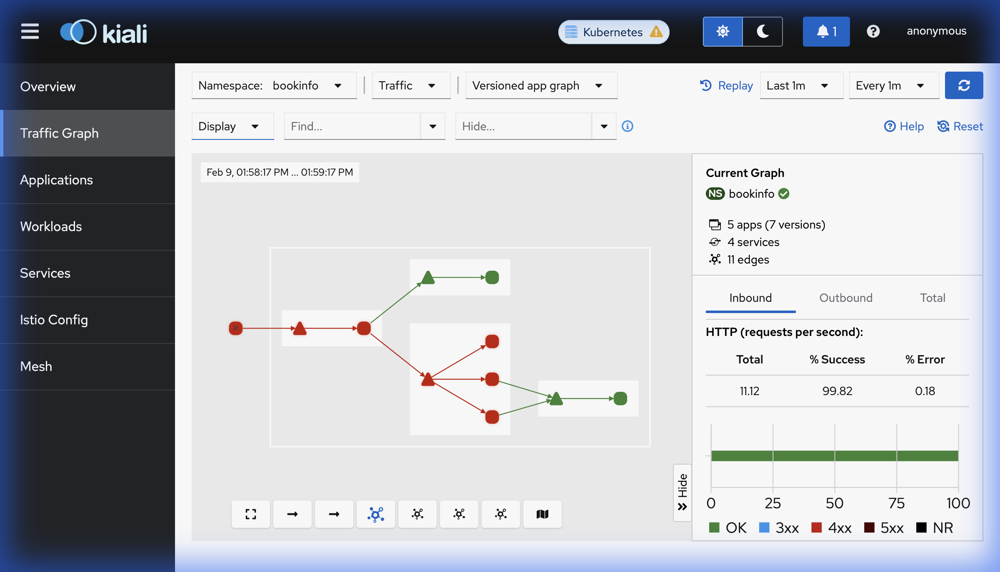
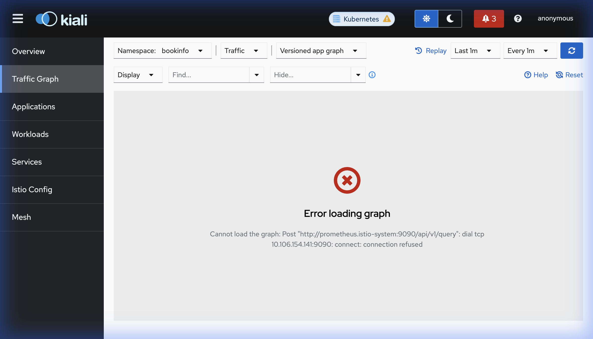

# Rapport d'Expérimentation : Équilibrage de Charge avec Istio

**Projet :** Routage de Trafic et Algorithmes d'Équilibrage de Charge (Load Balancing) sur Istio Service Mesh & Minikube.  
**Application :** Istio Bookinfo Sample (`productpage`, `reviews`, `ratings`, `details`).  
**Cible de test :** Service `ratings` mis à l'échelle à 3 réplicas (`ratings-v1`).  
**Outils d'observabilité :** Kiali, Jaeger (tracing distribué), Grafana.

---

## 1. Contexte & Architecture du Test

L'architecture s'appuie sur le maillage de services **Istio** déployé sur un cluster **Minikube**. L'injection automatique de sidecars Envoy (`istio-injection=enabled`) a été activée sur le namespace `bookinfo`.

Pour mettre en évidence le comportement des politiques de répartition de charge de la couche 7 (L7) :
1. Le microservice `ratings-v1` a été scalé à **3 pods réplicas**.
2. Des ressources `DestinationRule` ont été appliquées pour configurer les algorithmes de la directive `trafficPolicy.loadBalancer`.
3. Le flux de requêtes a été généré via l'**Istio Ingress Gateway** vers `/productpage` et observé en temps réel sur le graphe de topologie **Kiali** et les traces **Jaeger**.

---

## 2. Politiques Expérimentées & Résultats

### A. Round Robin (Politique par défaut)

* **Principe :** Distribution séquentielle et cyclique de chaque requête entrante sur l'ensemble des instances saines disponibles ($A \to B \to C \to A \dots$).
* **Manifeste Istio :**
```yaml
apiVersion: networking.istio.io/v1
kind: DestinationRule
metadata:
  name: ratings
  namespace: bookinfo
spec:
  host: ratings
  trafficPolicy:
    loadBalancer:
      simple: ROUND_ROBIN
```
* **Résultat & Observation Kiali :**
  La distribution de charge mesurée est quasiment uniforme (environ **33.3%** du trafic par pod réplica).
  
  

---

### B. Least Connections (`LEAST_CONN`)

* **Principe :** Redirection dynamique de chaque nouvelle requête vers l'instance de backend ayant le plus faible nombre de connexions TCP/HTTP actives.
* **Manifeste Istio :**
```yaml
apiVersion: networking.istio.io/v1
kind: DestinationRule
metadata:
  name: ratings
  namespace: bookinfo
spec:
  host: ratings
  trafficPolicy:
    loadBalancer:
      simple: LEAST_CONN
```
* **Résultat & Observation Kiali :**
  Sous un trafic régulier à temps de réponse quasi-instantané, les connexions se ferment très rapidement, produisant une distribution statistiquement proche du Round Robin. Cependant, sous des variations de latence ou des charges asynchrones hétérogènes, cette politique protège activement les réplicas saturés contre les surcharges.
  
  

---

### C. Consistent Hashing (Affinité de Session / Stickiness)

* **Principe :** Hachage cohérent d'un attribut de la requête (en-tête HTTP, cookie, ou IP source) pour garantir qu'un même utilisateur soit systématiquement routé vers le **même pod réplica**.
* **Manifeste Istio (Header `x-user`) :**
```yaml
apiVersion: networking.istio.io/v1
kind: DestinationRule
metadata:
  name: ratings
  namespace: bookinfo
spec:
  host: ratings
  trafficPolicy:
    loadBalancer:
      consistentHash:
        httpHeaderName: x-user
```
* **Test de Validation du Comportement Sticky :**
  * `curl -H "x-user: user1" ...` $\to$ Routé à 100% vers le **Réplica #1**.
  * `curl -H "x-user: user2" ...` $\to$ Routé à 100% vers le **Réplica #2**.
* **Résultat & Observation Kiali :**
  Le comportement est déterministe : tant que l'identité (`x-user`) ne change pas, le trafic ne bascule pas d'un pod à l'autre.
  
  

---

## 3. Synthèse Comparative

| Politique | Algorithme Envoy | Cas d'usage recommandé | Comportement sous charge |
| :--- | :--- | :--- | :--- |
| **Round Robin** | `ROUND_ROBIN` | Services sans état (stateless) avec requêtes homogènes. | Distribution égale (33% / pod). |
| **Least Connections** | `LEAST_CONN` | Traitements hétérogènes, requêtes longues ou lourdes (I/O intensif). | Équilibre la charge active en évitant les pods engorgés. |
| **Consistent Hashing** | `CONSISTENT_HASH` | Applications nécessitant une affinité de session (stateful, cache local). | Routage déterministe vers le même pod réplica par clé de hachage. |

---

## 4. Conclusion

Les `DestinationRule` d'Istio permettent d'abstraire la logique d'équilibrage de charge au niveau de la couche réseau (Service Mesh / Envoy sidecar). Aucune ligne de code de l'application Bookinfo n'a été modifiée pour passer d'un load balancing simple (Round-Robin) à un routage avec affinité de session complexe (Consistent Hashing).
